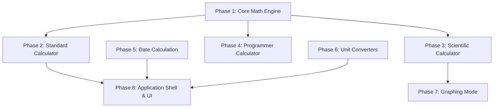

# CalcCraft Feature Specification & Agent Tracking Matrix

> **Target audience:** autonomous AI agents and pair-programming assistants working on CalcCraft.
> **Purpose:** catalog of the Windows Calculator features, their dependencies, and how far the
> Rust reimplementation has got.
> **Specification:** the Windows Calculator (`microsoft/calculator`, a local clone is in
> `../win-calculator`). Its behavior wins whenever this file and the real app disagree.
> **Implementation:** CalcCraft, Rust + eframe/egui. Read [AGENTS.md](AGENTS.md) first: it has the
> architecture, the conventions and the Windows behaviors the tests pin down.

---

## 1. Agent Operational Protocol

### 1.1 State Machine
Every feature entry uses these states:
- `[ ] NOT_STARTED`: pending implementation.
- `[~] IN_PROGRESS`: currently being implemented by an active agent.
- `[-] BLOCKED`: blocked by unresolved dependencies or external blockers.
- `[x] COMPLETED`: implemented, tested, and checked against the acceptance criteria.

Every entry has a **Windows ref** (where the original implements it). Completed entries also have
a **Rust** line (where CalcCraft implements it) and, where the two differ, a **Differences** line.
A `Differences` line describes a deliberate choice or a known gap; gaps worth closing have their
own `NOT_STARTED` entry.

### 1.2 "What to Implement Next" Algorithm
1. Scan the feature matrix in **phase order** (Phase 1 → Phase 8).
2. Filter for items with status `[ ] NOT_STARTED`.
3. Check the `Depends On` list of each candidate: every dependency must be `[x] COMPLETED`.
4. Pick the candidate with the highest priority (`P0` > `P1` > `P2` > `P3`).
5. Set it to `[~] IN_PROGRESS` and note the branch before starting work.
6. When the implementation is done and the checks in section 5 pass, set it to `[x] COMPLETED`,
   add the `Rust` line, update the dashboard, and add a row to section 6.

---

## 2. Implementation Progress Dashboard

| Category | Total Features | Completed | In Progress | Blocked | Not Started |
| :--- | :---: | :---: | :---: | :---: | :---: |
| **Phase 1: Core Math Engine** | 8 | 8 | 0 | 0 | 0 |
| **Phase 2: Standard Calculator Mode** | 7 | 7 | 0 | 0 | 0 |
| **Phase 3: Scientific Calculator Mode** | 9 | 9 | 0 | 0 | 0 |
| **Phase 4: Programmer Calculator Mode** | 8 | 8 | 0 | 0 | 0 |
| **Phase 5: Date Calculation** | 4 | 4 | 0 | 0 | 0 |
| **Phase 6: Unit Conversion (13 categories)** | 14 | 13 | 0 | 0 | 1 |
| **Phase 7: Graphing Calculator** | 6 | 6 | 0 | 0 | 0 |
| **Phase 8: Application Shell, UX & Accessibility** | 11 | 10 | 0 | 1 | 0 |
| **TOTAL** | **67** | **65** | **0** | **1** | **1** |

*Last updated: 2026-10-16 (CalcCraft 1.0.0)*

---

## 3. Recommended Phased Implementation Roadmap



1. **Phase 1: Core engine** (`src/engine.rs`): exact rational arithmetic, a port of the Windows
   engine with and without operator precedence, parentheses, memory, history. *Done.*
2. **Phase 2: Standard mode** (`src/app.rs`): immediate execution calculator and its UI. *Done.*
3. **Phase 3: Scientific mode** (`src/engine/math.rs`, `src/app/scientific_view.rs`): the keypad and
   UI on the precedence engine, trigonometry, powers, logarithms, factorial, F-E and `exp`. *Done.*
4. **Phase 4: Programmer mode** (`src/engine/integer.rs`, `src/app/programmer_view.rs`): word
   sizes, radixes, bitwise logic, shifts, rotations, bit keypad. *Done.*
5. **Phase 5: Date calculation** (`src/dates.rs`, `src/app/date_view.rs`). *Done.*
6. **Phase 6: Unit converters** (`src/converter.rs`, `src/app/converter_view.rs`): 12 converters
   with Windows' units, factors and rounding. *Done, except the Currency converter.*
7. **Phase 7: Graphing mode** (`src/graphing.rs` and `src/graphing/`, `src/app/graphing_view.rs`,
   `src/app/graph_canvas.rs`, `src/app/graphing_keypad.rs`): expression parser, plotting, tracing,
   variable sliders, function analysis. *Done.*
8. **Phase 8: Shell & system** (`src/app.rs`, `src/app/access.rs`, `src/app/strings.rs`, `src/app/region.rs`,
   `src/locale.rs`): navigation, theming, layouts, hotkeys, accessibility, localization. *Done,
   except right-to-left and complex scripts, which egui can't draw yet.*

---

## 4. Detailed Feature Specifications

### Phase 1: Core Math Engine
*Numeric precision and calculation management. In CalcCraft this is `src/engine.rs`, which has no
UI code and is covered by unit tests.*

#### `FEAT-CORE-001` Arbitrary Precision Rational Arithmetic
- **Status:** `[x] COMPLETED`
- **Priority:** `P0`
- **Depends On:** None
- **Windows ref:** `src/CalcManager/Ratpack/rat.cpp`, `trans.cpp`, `itrans.cpp`
- **Rust:** `src/engine.rs` (`Number` = `num_rational::BigRational`, `normalize`, `sqrt`)
- **Description:** Exact rational numbers instead of IEEE-754 floating point, so
  `0.1 + 0.2 − 0.3 = 0` and `1 ÷ 3 × 3 = 1`.
- **Acceptance Criteria:**
  - Addition, subtraction, multiplication and division are exact.
  - The display shows 16 significant digits.
  - Division by zero produces the division-by-zero error.
- **Differences:** Windows keeps 32 digits of precision. CalcCraft is exact until a denominator
  grows beyond 256 bits, then rounds to 40 significant digits. Square roots are exact for perfect
  squares and 40+ digits otherwise.

#### `FEAT-CORE-002` Immediate Execution Calculator Engine
- **Status:** `[x] COMPLETED`
- **Priority:** `P0`
- **Depends On:** `FEAT-CORE-001`
- **Windows ref:** `src/CalcManager/CalculatorManager.cpp`, `CEngine/scicomm.cpp`
- **Rust:** `src/engine.rs` (`Calculator`, a port of `CCalcEngine::ProcessCommandWorker` and
  `CHistoryCollector`)
- **Description:** Left-to-right evaluation used by Standard mode: `3 + 3 × 2 = 12`.
- **Acceptance Criteria:**
  - The next operator press computes the subtotal; the expression line collapses to it (`2 + 3 +` → `5 +`).
  - Pressing another operator replaces the pending one.
  - Repeated `=` repeats the last operator and operand; a new number followed by `=` does too
    (`2 + 3 = 7 =` → `10`).
  - Decimal entry, digit accumulation (16 digits), sign toggle and backspace work.

#### `FEAT-CORE-003` Order of Operations Engine (Operator Precedence)
- **Status:** `[x] COMPLETED`
- **Priority:** `P0`
- **Depends On:** `FEAT-CORE-001`
- **Windows ref:** `src/CalcManager/CEngine/scicomm.cpp` (`m_fPrecedence`), `src/CalcManager/CEngine/History.cpp`
- **Rust:** `src/engine.rs` (`Calculator::with_precedence`, `binary`, `equals`, `precedence_stack`)
- **Description:** Precedence-based evaluation for Scientific mode: `3 + 3 × 2 = 9`. It's the
  same engine as Standard mode with Windows' precedence flag on.
- **Acceptance Criteria:**
  - `×` and `÷` bind tighter than `+` and `−`; pending operations wait on a stack of up to
    25 entries, as in Windows.
  - The expression line keeps the whole expression (`2 + 3 × 4 =`), and the display shows what
    can be computed so far (`2 + 3 × 4 +` shows `14`).
  - Changing an operator to a tighter one after its left side was computed adds brackets:
    `1 + 2 −` changed to `×` becomes `(1 + 2) ×`.
  - History records the whole expression, and repeated `=` repeats the last operation done.
- **Differences:** the Scientific mode (`FEAT-SCI-*`) and the Programmer mode (with its integer
  mode, `FEAT-PROG-*`) use it. `^`, `yroot` and `log base` bind tightest (`FEAT-SCI-001`), and
  the Scientific `mod` ranks with `×` and `÷` (`FEAT-SCI-008`).

#### `FEAT-CORE-004` Parentheses Evaluation Stack
- **Status:** `[x] COMPLETED`
- **Priority:** `P0`
- **Depends On:** `FEAT-CORE-003`
- **Windows ref:** `src/CalcManager/CEngine/scicomm.cpp` (`IDC_OPENP`, `IDC_CLOSEP`)
- **Rust:** `src/engine.rs` (`Command::OpenParen`, `Command::CloseParen`, `open_parentheses`)
- **Description:** Nested `(` and `)`, up to 25 levels, with precedence on.
- **Acceptance Criteria:**
  - The open parenthesis count is available for the `(` button, as in Windows.
  - `=` closes all open parentheses: `2 × ((3 + 4 =` → `14`.
  - Expressions inside parentheses evaluate first, and a number next to a parenthesis
    multiplies: `2(3)` and `(2)3` are `6`.
  - `)` without an open `(` is ignored; `()` is `(0)`.
  - Functions apply to a whole group: `(1 + 2) x²` shows `sqr(1 + 2)`.
- **Differences:** like in Windows, Standard mode has no parentheses. The Programmer mode's `(`
  key shows the count.

#### `FEAT-CORE-005` Percentage Calculation Logic
- **Status:** `[x] COMPLETED`
- **Priority:** `P1`
- **Depends On:** `FEAT-CORE-002`
- **Windows ref:** `src/CalcManager/CEngine/scicomm.cpp` (`IDC_PERCENT`)
- **Rust:** `src/engine.rs` (`Calculator::percent`)
- **Description:** Context-aware percentage, verified against calc.exe:
  - After `+` or `−`: a percentage of the left operand. `100 + 10%` → `100 + 10` → `110`.
  - After `×` or `÷`: the value divided by 100. `50 × 10%` → `5`, `50 ÷ 10%` → `500`.
  - **Without a pending operator: `0`** (`25%` shows `0`, not `0.25`).
- **Acceptance Criteria:**
  - Matches Windows Standard mode, including the expression line (`50 + 5`).
  - The same rules apply with precedence on: `50 + 10% =` → `50 + 5 =` → `55`.

#### `FEAT-CORE-006` Memory Storage & Recall System (MC, MR, M+, M−, MS)
- **Status:** `[x] COMPLETED`
- **Priority:** `P1`
- **Depends On:** `FEAT-CORE-001`
- **Windows ref:** `src/CalcManager/CalculatorManager.cpp`, `src/Calculator.ViewModels/StandardCalculatorViewModel.cs`
- **Rust:** `src/engine.rs` (`Command::Memory*`, `memory_add`, `memory_recall_item`, `memory_clear_item`)
- **Description:** A memory list, newest first (up to 100 values):
  - `MS` stores the display as a new item.
  - `MR` recalls the newest item.
  - `M+` / `M−` add to or subtract from the newest item, or create one when memory is empty.
  - `MC` clears all items.
- **Acceptance Criteria:**
  - `MC`, `MR` and `M˅` are disabled while memory is empty; `MS`, `M+` and `M−` are always enabled.
  - All memory buttons are disabled in the error state.
  - After a memory operation, the next digit starts a new number.

#### `FEAT-CORE-007` History Tape & Expression Tracking
- **Status:** `[x] COMPLETED`
- **Priority:** `P1`
- **Depends On:** `FEAT-CORE-002`
- **Windows ref:** `src/CalcManager/CalculatorHistory.cpp`, `src/CalcManager/CEngine/History.cpp`,
  `src/Calculator.ViewModels/HistoryViewModel.cs`
- **Rust:** `src/engine.rs` (`HistoryLine`, `history`, `recall_history`, `delete_history_item`, `clear_history`)
- **Description:** The last 20 calculations, newest first, as an expression and a result.
- **Acceptance Criteria:**
  - Clicking an entry restores its result and expression line.
  - The trash button clears the history; an entry's context menu deletes it.
  - Entries look like `12 + 5 =` above the result `17`. In Standard mode every completed binary
    operation is recorded, including the intermediate ones of a chain (`1 + 2 +` records
    `1 + 2 =`). With precedence on, the entry is the whole expression (`2 + 3 × 4 =`).
  - As in Windows, `5 =` records `5 =`, and a finished function followed by a new number
    records the function (`√(4)` → `2`).
- **Differences:** the history is not saved when the app closes, as in Windows.

#### `FEAT-CORE-008` Calculation Error & Edge Case Engine
- **Status:** `[x] COMPLETED`
- **Priority:** `P0`
- **Depends On:** `FEAT-CORE-001`
- **Windows ref:** `src/CalcManager/CEngine/scicomm.cpp`
- **Rust:** `src/engine.rs` (`CalcError`, `Calculator::display_error`, `is_enabled`)
- **Description:** Errors and their display strings:
  - `Cannot divide by zero` (`1 ÷ 0`, `1/x` of 0).
  - `Result is undefined` (`0 ÷ 0`).
  - `Invalid input` (square root of a negative number, or pasted text that isn't valid).
  - `Overflow` (decimal exponent beyond ±9999, in both directions).
- **Acceptance Criteria:**
  - In the error state only digits, `C`, `CE`, `⌫` and `=` work; pressing any of them leaves the
    error state (`=` does nothing else). The decimal point is disabled, as the number pad's
    `ErrorLayout` does in Windows (checked in calc.exe).
  - The expression line shows what Windows shows: `1 ÷` after `=`, `8 ÷ 0 +` after an operator, `1/(0)`.

---

### Phase 2: Standard Calculator Mode
*Daily calculator with immediate execution. UI in `src/app.rs`.*

#### `FEAT-STD-001` Basic Standard Keypad & Operator Set
- **Status:** `[x] COMPLETED`
- **Priority:** `P0`
- **Depends On:** `FEAT-CORE-002`
- **Windows ref:** `src/Calculator/Views/CalculatorStandardOperators.xaml`
- **Rust:** `src/app.rs` (`draw_keypad`, `keypad_label`, `button_flash`)
- **Description:** `0`–`9`, `.`, `+ − × ÷`, `=`, `⌫`, `CE`, `C`, `%`, plus the memory row.
- **Acceptance Criteria:**
  - Same 4 × 6 grid, labels, icons and colors as Windows 11 (the icons are Fluent System
    Icons built into the app, like Windows' Segoe Fluent Icons).
  - A second decimal point in one operand is ignored.
  - The display shrinks long numbers to fit, with en-US grouping (`1,234,567`).

#### `FEAT-STD-002` Unary Math Operators
- **Status:** `[x] COMPLETED`
- **Priority:** `P1`
- **Depends On:** `FEAT-CORE-001`, `FEAT-STD-001`
- **Windows ref:** `src/CalcManager/CEngine/scifunc.cpp`
- **Rust:** `src/engine.rs` (`Func`)
- **Description:** `1/x`, `x²`, `√x`, `±`.
- **Acceptance Criteria:**
  - They apply to the displayed operand at once and nest in the expression line:
    `sqr(sqr(4))`, `√(9)`, `1/(5)`, `negate(8)`.
  - `±` while typing flips the sign without changing the expression line.

#### `FEAT-STD-003` Standard History & Memory Panels
- **Status:** `[x] COMPLETED` (flyouts)
- **Priority:** `P1`
- **Depends On:** `FEAT-CORE-006`, `FEAT-CORE-007`, `FEAT-STD-001`
- **Windows ref:** `src/Calculator/Views/HistoryList.xaml`, `Memory.xaml`, `MemoryListItem.xaml`
- **Rust:** `src/app.rs` (`draw_flyout`, `history_item`, `memory_item`, `draw_context_menu`)
- **Description:** History (header button, `Ctrl+H`) and memory (`M˅`) panels.
- **Acceptance Criteria:**
  - The panel covers the keypad; clicking the display or pressing `Esc` closes it.
  - Memory items show `MC`, `M+` and `M−` on hover; clicking an item recalls it.
  - Right-clicking an item opens its context menu (`FEAT-STD-007`).
  - Empty panels show "There’s no history yet." / "There’s nothing saved in memory."
  - From 560 px wide, the panels dock next to the keypad instead (`FEAT-SHELL-002`).

#### `FEAT-STD-004` Always-on-Top (Compact Overlay) Mode
- **Status:** `[x] COMPLETED`
- **Priority:** `P2`
- **Depends On:** `FEAT-STD-001`
- **Windows ref:** `src/Calculator/Views/MainPage.xaml.cs`, `src/Calculator/Views/Calculator.xaml`
- **Rust:** `src/app.rs` (`set_compact`)
- **Description:** A small window that stays above other windows.
- **Acceptance Criteria:**
  - The window is always on top and shrinks to 320 × 394; leaving the mode restores the
    previous size.
  - The menu, title, history button and memory row are hidden; a back button returns to full view.
  - Only the result shows, without the expression line (`DisplayModeAlwaysOnTop`), and the
    history and memory shortcuts do nothing.
- **Differences:** the keypad rows never hide when the window gets very short.

#### `FEAT-STD-005` Keyboard Input & Hotkeys for Standard Mode
- **Status:** `[x] COMPLETED`
- **Priority:** `P1`
- **Depends On:** `FEAT-STD-001`
- **Windows ref:** `docs/ManualTests.md` (Hotkeys), `src/Calculator/Views/CalculatorStandardOperators.xaml`
- **Rust:** `src/app.rs` (`char_command`, `handle_key`)
- **Description:**
  - `0`–`9`, `.` or `,`, `+`, `-`, `*`, `/`, `%`, `Enter` or `=`
  - `Delete` = `CE`, `Esc` = `C` (or closes an open panel), `Backspace` = `⌫`, `F9` = `±`
  - `R` = `1/x`, `Q` = `x²`, `@` = `√x`
  - `Ctrl+M` (MS), `Ctrl+P` (M+), `Ctrl+Q` (M−), `Ctrl+R` (MR), `Ctrl+L` (MC)
  - `Ctrl+H` (history), `Ctrl+Shift+D` (clear history)
- **Acceptance Criteria:**
  - All hotkeys work without focusing a button, and the pressed key's button flashes.
  - While the history or memory flyout is open, the keypad and memory keys do nothing
    (`EnableControls(false)`); `Esc`, `Ctrl+H`, `Ctrl+Shift+D`, copy and paste still work.
  - `Alt` with any other key types nothing.
  - Buttons never take keyboard focus, so `Enter` always means `=` (see AGENTS.md pitfalls).

#### `FEAT-STD-006` Clipboard Copy and Paste (numbers)
- **Status:** `[x] COMPLETED`
- **Priority:** `P2`
- **Depends On:** `FEAT-STD-001`
- **Windows ref:** `src/Calculator.ViewModels/Common/CopyPasteManager.cs`
- **Rust:** `src/engine.rs` (`copy_text`, `paste`)
- **Description:** `Ctrl+C` copies the displayed value; `Ctrl+V` pastes a number.
- **Acceptance Criteria:**
  - Copy leaves out the grouping commas (`1234.5`); nothing is copied in the error state.
  - Paste ignores spaces, grouping commas, quotes and currency signs, and accepts up to 16
    digits: `"1,234.5"` → `1,234.5`, `"-007"` → `-7`, `"$12"` → `12`. Invalid text shows
    `Invalid input` (see `FEAT-STD-007`).

#### `FEAT-STD-007` Expression Paste & Panel Context Menus
- **Status:** `[x] COMPLETED`
- **Priority:** `P3`
- **Depends On:** `FEAT-STD-006`
- **Windows ref:** `src/Calculator.ViewModels/Common/CopyPasteManager.cs`,
  `src/Calculator.ViewModels/StandardCalculatorViewModel.cs` (`OnPaste`),
  `src/Calculator/Views/HistoryList.xaml`, `Memory.xaml` (context menus)
- **Rust:** `src/engine.rs` (`paste`, `paste_is_valid`, `extract_operands`), `src/app.rs` (`draw_context_menu`)
- **Description:** Paste `"12 + 5 ="` and evaluate it. History items have a context menu with
  Copy and Delete; memory items have one with "Clear memory item", "Add to memory item" and
  "Subtract from memory item". As in Windows, memory items can't be copied.
- **Acceptance Criteria:**
  - Pasted text follows the rules and limits of `CopyPasteManager`: at most 512 characters,
    100 operands and 16 digits per operand (32 with precedence on, where parentheses are allowed).
  - Valid text is typed in key by key after a `CE`: `"12 + 5 ="` → `17`, `"2*-3="` → `-6`
    (a `-` at the start or after an operator becomes `±` after the first non-zero digit).
  - Invalid clipboard text shows `Invalid input`, as in Windows.
  - Copy in the history menu copies the result as the list shows it (`1,236`).
  - The menu opens at the pointer; a click outside it or `Esc` closes it.
- **Also:** numbers in e-notation (`1e5`, `1.5e-3`) paste through `exp` (`FEAT-SCI-006`).
- **Differences:** the memory menu shows `MC`, `M+` and `M−` as text, since CalcCraft doesn't
  ship the Calculator's own icon font.

---

### Phase 3: Scientific Calculator Mode
*Scientific operations, trigonometry and logarithms. Logic in `src/engine/math.rs` (the
functions, after `ratpak`) and `src/engine.rs` (`Calculator::with_precedence()`), UI in
`src/app/scientific_view.rs`. The behaviors the tests pin down are listed in AGENTS.md.*

> **Rust notes for the whole phase:** `BigRational` has no `sin`, `ln` or real powers. No
> multi-precision crate was added: `math.rs` computes the series itself on `Float`, a binary
> floating point number with a `num-bigint` mantissa of about 400 bits, and rounds every result
> to 40 significant digits (`INTERNAL_DIGITS`), so exact results stay exact rationals
> (`sin(30°)` is 0.5) and the 32 digits shown are those of the exact value. Windows'
> `ratpak` domain checks are ported function by function.

#### `FEAT-SCI-001` Expanded Powers and Roots
- **Status:** `[x] COMPLETED`
- **Priority:** `P1`
- **Depends On:** `FEAT-CORE-003`
- **Windows ref:** `src/CalcManager/CEngine/scifunc.cpp`, `scioper.cpp`, `Ratpack/exp.cpp` (`powrat`, `powratcomp`)
- **Rust:** `src/engine/math.rs` (`power`, `root`, `exp`), `src/engine.rs` (`Op::Power`, `Op::Root`,
  `Func::Square`, `Cube`, `SquareRoot`, `CubeRoot`, `TenToX`, `TwoToX`, `EToX`)
- **Description:** $x^y$, $10^x$, $e^x$, $2^x$, $\sqrt[y]{x}$, $\sqrt[3]{x}$, $x^3$, $x^2$.
- **Acceptance Criteria:**
  - Accurate for positive, negative and fractional exponents: integer powers are exact, and
    exact roots are exact (`8 yroot 3` is 2, `27^(2/3)` is 9, `(−8)^(1/3)` is −2).
  - Invalid operations (an even root of a negative number, 0 to a negative power, a result beyond
    e^±100000) show `Invalid input`; the 0th root divides by zero.
  - `xʸ`, `ʸ√x` and `logᵧx` bind tighter than `×` and `÷` (`NPrecedenceOfOp` 4).
- **Differences:** none known.

#### `FEAT-SCI-002` Trigonometric Functions & Angle Modes (DEG, RAD, GRAD)
- **Status:** `[x] COMPLETED`
- **Priority:** `P1`
- **Depends On:** `FEAT-CORE-003`
- **Windows ref:** `src/CalcManager/Ratpack/trans.cpp`, `CEngine/scicomm.cpp` (`IsCurrentTooBigForTrig`),
  `src/Calculator/Views/CalculatorScientificAngleButtons.xaml(.cs)`
- **Rust:** `src/engine/math.rs` (`sin`, `cos`, `tan`, `sin_cos`, `Angle`), `src/engine.rs`
  (`Func::Trig`, `Command::Angle`, `trig_function`), `src/app/scientific_view.rs` (`draw_angle_row`)
- **Description:** `sin`, `cos`, `tan`, `csc`, `sec`, `cot`, with Degrees, Radians and Gradians.
- **Acceptance Criteria:**
  - $\sin(90^\circ) = 1$, $\sin(\pi/2 \text{ rad}) = 1$, $\sin(100 \text{ grad}) = 1$; degrees
    and gradians are reduced exactly, and sines and cosines within 10^-32 of 0 are 0.
  - Asymptotes such as $\tan(90^\circ)$ give `Invalid input`; `csc(0)` divides by zero; values
    from 10^100 on are `Invalid input`.
  - The expression line names the unit: `sin₀(30)`, `sinᵣ(1)`, `sin₉(100)`.
  - The unit button cycles DEG → RAD → GRAD; `F4`, `F5` and `F3` pick radians, gradians and
    degrees, as in Windows (checked in calc.exe).
- **Differences:** angles in radians are reduced with as many digits of π as they need, so huge
  arguments (`sin(10^22)`) are exact; in the error state the unit button clears the error and
  switches (Windows shows the new unit but keeps the old one in its engine).

#### `FEAT-SCI-003` Inverse and Hyperbolic Trigonometry (2nd & hyp)
- **Status:** `[x] COMPLETED`
- **Priority:** `P2`
- **Depends On:** `FEAT-SCI-002`
- **Windows ref:** `src/Calculator/Views/CalculatorScientificOperators.xaml(.cs)`, `Ratpack/itrans.cpp`,
  `transh.cpp`, `itransh.cpp`, `CalculatorManager.cpp` (`CommandASIN` …)
- **Rust:** `src/engine/math.rs` (`asin`, `acos`, `atan`, `sinh`, `cosh`, `tanh`, `asinh`, `acosh`,
  `atanh`, `invert`), `src/engine.rs` (`Trig`, `TrigFunction`), `src/app/scientific_view.rs`
  (the Trigonometry menu)
- **Description:** `2nd` gives $\sin^{-1}$ … $\cot^{-1}$; `hyp` gives $\sinh$ … $\coth$; both give $\sinh^{-1}$ ….
- **Acceptance Criteria:**
  - The Trigonometry menu's labels and actions switch while `2nd` or `hyp` is on; a function
    turns both off and closes the menu.
  - Inverse results come in the angle unit (`sin⁻¹(0.5)` is 30 in degrees); `|x| > 1` is
    `Invalid input` for `sin⁻¹`, `x < 1` for `cosh⁻¹`; `tanh⁻¹(1)` divides by zero.
  - Keys: `S` `O` `T` `U` `I` `J`, inverse with `Shift`, hyperbolic with `Ctrl`, both with
    `Ctrl+Shift`.
- **Differences:** none known.

#### `FEAT-SCI-004` Logarithms and Exponentials
- **Status:** `[x] COMPLETED`
- **Priority:** `P1`
- **Depends On:** `FEAT-CORE-003`
- **Windows ref:** `src/CalcManager/Ratpack/exp.cpp` (`lograt`, `log10rat`, `exprat`), `CEngine/scioper.cpp` (`IDC_LOGBASEY`)
- **Rust:** `src/engine/math.rs` (`ln`, `log10`, `log_base`, `exp`), `src/engine.rs` (`Func::Ln`,
  `Func::Log`, `Func::EToX`, `Op::LogBase`)
- **Description:** $\ln(x)$, $\log_{10}(x)$, $\log_y(x)$, $e^x$.
- **Acceptance Criteria:**
  - $\ln(e) = 1$, $\log_{10}(1000) = 3$, `8 log base 2 = 3`.
  - $x \le 0$ shows `Invalid input`; `log base 1` divides by zero (and `1 log base 1` is
    undefined).
- **Differences:** none known.

#### `FEAT-SCI-005` Mathematical Constants & Special Unary Functions
- **Status:** `[x] COMPLETED`
- **Priority:** `P1`
- **Depends On:** `FEAT-CORE-001`
- **Windows ref:** `src/CalcManager/CEngine/scicomm.cpp` (`IDC_PI`, `IDC_EULER`, `IDC_RAND`), `scifunc.cpp`,
  `Ratpack/fact.cpp` (`factrat`)
- **Rust:** `src/engine/math.rs` (`pi`, `euler`, `random`, `factorial`, `gamma_unit`, `floor`,
  `ceil`), `src/engine.rs` (`Command::Pi`, `Euler`, `Random`, `constant`, `Func::Factorial`, `Abs`,
  `Floor`, `Ceil`)
- **Description:** $\pi$, $e$, `rand`, factorial $n!$, absolute value $|x|$, $\lfloor x \rfloor$, $\lceil x \rceil$.
- **Acceptance Criteria:**
  - Constants are entered with full internal precision (`3.1415926535897932384626433832795`),
    and replace the typed number (`2π` is π).
  - Factorial of non-integers follows Windows (gamma function: `0.5!` matches calc.exe in all
    32 digits); negative integers show `Invalid input`, beyond 3249 or below −1000 `Overflow`.
- **Differences:** `rand` takes its random bits from a small generator seeded by the clock and
  the system, not from `mt19937`.

#### `FEAT-SCI-006` Notation & Formatting Toggles (F-E, exp)
- **Status:** `[x] COMPLETED`
- **Priority:** `P2`
- **Depends On:** `FEAT-CORE-001`
- **Windows ref:** `src/Calculator.ViewModels/StandardCalculatorViewModel.cs` (`IsFToEChecked`),
  `CEngine/CalcInput.cpp` (`TryBeginExponent`), `Ratpack/conv.cpp` (`NumberToString`)
- **Rust:** `src/engine.rs` (`Command::ToggleNotation`, `Command::Exponent`, `Exponent`,
  `format_with`), `src/app/scientific_view.rs` (`draw_angle_row`)
- **Description:** `F-E` toggles fixed and scientific notation; `exp` enters an exponent (`3.5e+4`).
- **Acceptance Criteria:**
  - Scientific notation uses Windows' format (`1.2345e+4`, `5.e+0`, `0.e+0`), on the display,
    in the expression line and in the history; `C` and `CE` turn F-E off.
  - `exp` adds a decimal point, takes up to 4 digits, `±` flips the exponent's sign and `⌫`
    removes it; a number beyond Windows' 4-digit exponents is `Overflow`.
  - Paste accepts e-notation in the Standard and Scientific modes (`1.5e-3`).
- **Differences:** in the error state F-E clears the error and switches (Windows' button shows
  the new state but its engine keeps the old one).

#### `FEAT-SCI-007` DMS (Degrees, Minutes, Seconds) Converter
- **Status:** `[x] COMPLETED`
- **Priority:** `P2`
- **Depends On:** `FEAT-SCI-002`
- **Windows ref:** `src/CalcManager/CEngine/scifunc.cpp` (`IDC_DMS`, `IDC_DEGREES`)
- **Rust:** `src/engine/math.rs` (`dms`), `src/engine.rs` (`Func::Dms`, `Func::Degrees`)
- **Description:** `→dms` converts decimal degrees to D.MMSS; `→deg` converts back.
- **Acceptance Criteria:**
  - $30.5^\circ \rightarrow 30.30$ ($30^\circ 30'$), and back.
  - Like Windows, `→deg` after `=` hides the expression line, and it isn't a function to the
    engine (a new number replaces it); checked in calc.exe.
- **Differences:** none known.

#### `FEAT-SCI-008` Modulo Operator (mod)
- **Status:** `[x] COMPLETED`
- **Priority:** `P1`
- **Depends On:** `FEAT-CORE-003`
- **Windows ref:** `src/CalcManager/CEngine/scioper.cpp`, `Ratpack/logic.cpp` (`modrat`)
- **Rust:** `src/engine/math.rs` (`modulo`), `src/engine.rs` (`Op::Mod` outside the integer mode)
- **Description:** Binary remainder operator.
- **Acceptance Criteria:**
  - $10 \text{ mod } 3 = 1$ (`10 Mod 3 =`); the result has the sign of the divisor
    (`−10 mod 3` is 2, `10 mod −3` is −2), and `x mod 0` is x.
- **Differences:** none known.

#### `FEAT-SCI-009` Scientific Mode UI
- **Status:** `[x] COMPLETED`
- **Priority:** `P0`
- **Depends On:** `FEAT-SCI-001`, `FEAT-SCI-002`
- **Windows ref:** `src/Calculator/Views/Calculator.xaml` (`Scientific` state),
  `CalculatorScientificOperators.xaml(.cs)`, `CalculatorScientificAngleButtons.xaml(.cs)`,
  `CalculatorManager.cpp` (`SetScientificMode`), `Common/KeyboardShortcutManager.cs`
- **Rust:** `src/app/scientific_view.rs`, `src/app.rs` (`Mode::Scientific`, `engine`, `set_mode`,
  `Kind::Emphasized`, `draw_memory_row_enabled`, `layout_wrapped_right`), `tools/import-strings.ps1`
- **Description:** The Scientific mode in the menu (`Alt+2`): display with 32 digits, the
  angle unit and F-E, the memory row, the Trigonometry and Function menus and the 5 × 7 keys
  with `2nd`, `π`, `e`, `C`/`CE`, `⌫`, `x²`, `1/x`, `|x|`, `exp`, `mod`, `√x`, parentheses with
  their count, `n!`, `xʸ`, `10ˣ`, `log`, `ln`, `±` and the digits.
- **Acceptance Criteria:**
  - Sizes from `Calculator.xaml`'s star rows (results 26, 46 or 72 px, the 544 px trigger) and
    the `Small`, `Medium` and `Large` states of the keys; compared side by side with calc.exe
    at its minimum and a wide size.
  - `2nd` swaps the first column (`x³`, `∛x`, `ʸ√x`, `2ˣ`, `logᵧx`, `eˣ`) with the accent
    hover, and using one turns it off.
  - Its own history, memory shared with the other modes; the history and memory flyouts cover
    the keys only, and the lists wrap 32-digit results like Windows'.
  - Windows' keyboard shortcuts, screen reader names in 60 languages (59 new strings), both
    themes.
- **Differences:** the key labels and the menus' icons are Segoe UI text and drawings, since
  Windows takes them from the Calculator's own icon font. The flyouts don't dim the rows above
  them (Windows lays a smoke layer over them).

---

### Phase 4: Programmer Calculator Mode
*Binary, hex, bitwise logic and word sizes. Logic in `src/engine/integer.rs` (Windows' integer
mode of `CCalcEngine`, run by `Calculator::programmer()` in `src/engine.rs`), UI in
`src/app/programmer_view.rs`. The behaviors the tests pin down are listed in AGENTS.md.*

> **Rust notes for the whole phase:** the plan was `i64`/`u64` with masking, but Windows runs the
> Programmer mode on the same engine as the Scientific mode, with rationals that its `DisplayNum`
> truncates to the word size. CalcCraft does the same (`IntegerMode::truncate` at Windows'
> `DisplayNum` points), because a quotient or a right shift inside parentheses keeps its fraction
> for the next operation: `(255 AND 10 − 7 ÷ 2) =` is 6 in Windows and with rationals, 7 with
> 64-bit integers. The integer mode's logic is still in its own module without UI code.

#### `FEAT-PROG-001` Multi-Radix Number Bases (HEX, DEC, OCT, BIN)
- **Status:** `[x] COMPLETED`
- **Priority:** `P0`
- **Depends On:** `FEAT-CORE-001`
- **Windows ref:** `src/Calculator/Views/CalculatorProgrammerOperators.xaml`, `src/CalcManager/CEngine/scicomm.cpp`
- **Rust:** `src/engine/integer.rs` (`Radix`, `IntegerMode::format`, `group`, `pad_binary`,
  `digit_fits`), `src/engine.rs` (`Command::Radix`, `set_radix`, `radix_values`),
  `src/app/programmer_view.rs` (`draw_radix_list`)
- **Description:** The value shown in all four radixes at once, typed in the selected one.
- **Acceptance Criteria:**
  - Digits that don't exist in the radix are disabled (A–F outside HEX, 8–9 in OCT, 2–9 in BIN).
  - Entry lengths are limited by the word size, as in Windows (`CalcInput::TryAddDigit`).
  - HEX and BIN show groups of 4, OCT groups of 3, DEC the region's grouping; BIN starts with a
    whole group (`0010`) and wraps in the list. In the error state the list is empty.
  - A new radix finishes a typed number and rewrites the expression line's operands, from their
    unsigned values as in Windows (`-5 +` → `FFFFFFFFFFFFFFFB +`).
  - Right-clicking a radix offers Copy, which copies its value without digit groups.
- **Differences:** none known.

#### `FEAT-PROG-002` Word Sizes (QWORD, DWORD, WORD, BYTE)
- **Status:** `[x] COMPLETED`
- **Priority:** `P0`
- **Depends On:** `FEAT-PROG-001`
- **Windows ref:** `src/CalcManager/CalculatorManager.cpp`, `CEngine/sciset.cpp` (`SetRadixTypeAndNumWidth`),
  `src/Calculator/Views/CalculatorProgrammerDisplayPanel.xaml`
- **Rust:** `src/engine/integer.rs` (`WordSize`, `IntegerMode::truncate`, `signed`),
  `src/engine.rs` (`Command::WordSize`, `set_word_size`, `display_num`),
  `src/app/programmer_view.rs` (`draw_programmer_controls`)
- **Description:** 64, 32, 16 and 8 bit two's complement values.
- **Acceptance Criteria:**
  - Switching to a smaller size truncates (`0x1FFFF` in WORD becomes `0xFFFF`).
  - Correct sign extension and two's complement display in DEC (`FF` in a BYTE is `-1`, and
    `FFFF` in a WORD).
  - The word size button cycles QWORD → DWORD → WORD → BYTE and is disabled in the error state.

#### `FEAT-PROG-003` Bitwise Logic Operations
- **Status:** `[x] COMPLETED`
- **Priority:** `P1`
- **Depends On:** `FEAT-PROG-002`
- **Windows ref:** `src/CalcManager/CEngine/scioper.cpp`, `scifunc.cpp` (`IDC_COM`), `Ratpack/logic.cpp`
- **Rust:** `src/engine/integer.rs` (`IntegerMode::apply`, `not`, `boolean`), `src/engine.rs`
  (`Op::And` … `Op::Nor`, `Func::Not`), `src/app/programmer_view.rs` (the Bitwise menu)
- **Description:** `AND`, `OR`, `NOT`, `XOR`, `NAND`, `NOR` (Windows has no `XNOR`).
- **Acceptance Criteria:**
  - `0b1010 AND 0b1100 = 0b1000`.
  - `NOT` respects the word size (in BYTE, `NOT 0` is `0xFF`).
  - Windows' precedence: `OR` and `XOR` below `AND`, `NAND` and `NOR`, below `+ −`, below
    `× ÷ %` and the shifts. The Bitwise menu is a 3 × 2 flyout under its button.

#### `FEAT-PROG-004` Bit Shifts (Logical & Arithmetic)
- **Status:** `[x] COMPLETED`
- **Priority:** `P1`
- **Depends On:** `FEAT-PROG-002`
- **Windows ref:** `src/CalcManager/CEngine/scioper.cpp`, `src/Calculator/Views/CalculatorProgrammerRadixOperators.xaml(.cs)`
- **Rust:** `src/engine/integer.rs` (`Op::LeftShift`, `RightShift`, `RightShiftLogical` in
  `IntegerMode::apply`), `src/app/programmer_view.rs` (`ShiftMode`, the Bit shift menu)
- **Description:** Left shift, logical right shift, arithmetic right shift (the shift type is chosen as in Windows).
- **Acceptance Criteria:**
  - In BYTE: `0b10000000` arithmetic right shift 1 = `0b11000000`.
  - A shift by the word size or more shows `Result not defined`.
  - The Bit shift menu's choice (arithmetic, logical, rotate circular, rotate through carry)
    decides what the two shift keys and `<` / `>` do.

#### `FEAT-PROG-005` Bit Rotations (RoL, RoR, rotate through carry)
- **Status:** `[x] COMPLETED`
- **Priority:** `P1`
- **Depends On:** `FEAT-PROG-002`
- **Windows ref:** `src/CalcManager/CEngine/scifunc.cpp` (`IDC_ROL`, `IDC_ROLC`, …)
- **Rust:** `src/engine/integer.rs` (`IntegerMode::rotate`, `carry`), `src/engine.rs`
  (`Func::RotateLeft` … `RotateRightCarry`)
- **Description:** Circular rotation within the word size, by one bit, as a function (`RoL(x)`).
- **Acceptance Criteria:**
  - In BYTE: `0b10000001 RoL = 0b00000011`.
  - Through carry, the bit that falls out is kept for the next rotation; `C` clears the carry.

#### `FEAT-PROG-006` Bit Toggling Keypad
- **Status:** `[x] COMPLETED`
- **Priority:** `P2`
- **Depends On:** `FEAT-PROG-001`, `FEAT-PROG-002`
- **Windows ref:** `src/Calculator/Views/CalculatorProgrammerBitFlipPanel.xaml` (and `.xaml.cs`)
- **Rust:** `src/engine/integer.rs` (`IntegerMode::toggle_bit`), `src/engine.rs`
  (`Command::ToggleBit`, `bits`), `src/app/programmer_view.rs` (`draw_bit_panel`)
- **Description:** 64 clickable bits in groups of four.
- **Acceptance Criteria:**
  - Clicking a bit flips it and updates every radix at once.
  - Bits above the word size are disabled.
  - Set bits are in the accent color; each group is labeled with its lowest bit's number, and
    Narrator reads "5th bit, value 1".

#### `FEAT-PROG-007` Hotkeys for Programmer Mode
- **Status:** `[x] COMPLETED`
- **Priority:** `P2`
- **Depends On:** `FEAT-PROG-001`
- **Windows ref:** `src/Calculator/Common/KeyboardShortcutManager.cs`, `Resources.resw`
  (`*.KeyboardShortcutManager.*`), `src/Calculator/Views/CalculatorProgrammer*.xaml`
- **Rust:** `src/app/programmer_view.rs` (`ProgrammerState::char_command`, `key_command`),
  `src/app.rs` (`handle_keyboard`, `handle_key`)
- **Description:**
  - `F5` (HEX), `F6` (DEC), `F7` (OCT), `F8` (BIN)
  - `F12` (QWORD), `F2` (DWORD), `F3` (WORD), `F4` (BYTE)
  - `&` (AND), `|` (OR), `~` (NOT), `^` (XOR), `.` (NAND), `\` (NOR), `<` / `>` (shifts),
    `%` (mod), `A`–`F` (hex digits)
- **Acceptance Criteria:**
  - Checked against the Windows source and the real calculator: the word size keys are the
    shortcuts of the four (mostly hidden) word size buttons, each switching to the next size;
    `.` and `\` are NAND and NOR, since the decimal point is disabled; `<` and `>` follow the
    Bit shift menu. The mode's own keys override the Standard ones (`%` is mod here).

#### `FEAT-PROG-008` Programmer Mode UI
- **Status:** `[x] COMPLETED`
- **Priority:** `P0`
- **Depends On:** `FEAT-PROG-001`, `FEAT-PROG-002`
- **Windows ref:** `src/Calculator/Views/Calculator.xaml` (`Programmer` state),
  `CalculatorProgrammerRadixOperators.xaml`, `StandardCalculatorViewModel.cs`, `CalculatorManager.cpp`
  (`SetProgrammerMode`), `Calculator.ViewModels/Common/CopyPasteManager.cs`
- **Rust:** `src/app/programmer_view.rs`, `src/app.rs` (`Mode::Programmer`, `engine`, `set_mode`),
  `src/engine.rs` (`programmer_paste_is_valid`, `reset`, `take_memory`)
- **Description:** The Programmer mode in the menu (`Alt+4`): display, radix list, keypad
  switches, word size, `MS` and `M˅`, the Bitwise and Bit shift menus and the 5 × 6 keypad
  (`A`–`F`, shifts, `C`/`CE`, `⌫`, parentheses with their count, `%`, `÷ × − +`, `±`, `=`).
- **Acceptance Criteria:**
  - Sizes from `Calculator.xaml`'s star rows; the result font is 26, 46 or 72 px by window
    height, and the keys grow in the `Medium` and `Large` states, as in Windows.
  - Memory is shared with the Standard mode and shown in the current radix; the memory list
    docks from 560 px (without a History tab); there is no history.
  - Switching between Standard and Programmer resets the mode switched to, as in Windows.
  - Paste checks the text with `CopyPasteManager`'s Programmer rules (`0x1F`, `1Fh`, `0b101`,
    `255u`, `1_000`, the word size's limits) and types it in.
  - Both themes, the keyboard focus and Narrator names as in Windows.
- **Differences:** the keypad switch, Bitwise and Bit shift icons are drawn in code and the
  shift keys' `«` and `»` are two chevron icons, since Windows takes them from the Calculator's
  own icon font. Windows leaves `«` enabled in the error state; CalcCraft disables both shift keys.
  The decimal key shows `.` in every region, as in the Standard mode.

---

### Phase 5: Date Calculation
*Date difference and date arithmetic. Logic in `src/dates.rs` (port of `DateCalculationEngine`),
UI in `src/app/date_view.rs`. Detailed rules: `../win-calculator/date_calculation.md` and AGENTS.md.*

#### `FEAT-DATE-001` Date Difference Engine
- **Status:** `[x] COMPLETED`
- **Priority:** `P1`
- **Depends On:** None
- **Windows ref:** `src/Calculator.ViewModels/Common/DateCalculator.cs`, `DateCalculatorViewModel.cs`
- **Rust:** `src/dates.rs` (`difference`, `describe_difference`, `days_between`)
- **Description:** Years → months → weeks → days, each counted from where the previous unit
  ended, with month-end clamping.
- **Acceptance Criteria:**
  - Equal dates show `Same dates`.
  - Under 7 days, only the days are shown and the second line is hidden.
  - Otherwise the first line lists the non-zero units (`1 week, 3 days`) and the second the total (`10 days`).
  - The order of the two dates doesn't matter; leap years and month ends match Windows.

#### `FEAT-DATE-002` Add or Subtract Date Offsets
- **Status:** `[x] COMPLETED`
- **Priority:** `P1`
- **Depends On:** None
- **Windows ref:** `src/Calculator.ViewModels/Common/DateCalculator.cs`
- **Rust:** `src/dates.rs` (`add`, `subtract`)
- **Description:** Years, months and days (0–999 each) added to or subtracted from a date.
- **Acceptance Criteria:**
  - Add goes years → months → days, subtract days → months → years, with month-end clamping.
  - Results outside 1601-01-01 … 9999-12-31 show `Date out of Bound`.
  - The result reads `Thursday, October 15, 2026`.

#### `FEAT-DATE-003` Singular / Plural Formatting
- **Status:** `[x] COMPLETED` (English)
- **Priority:** `P2`
- **Depends On:** `FEAT-DATE-001`, `FEAT-DATE-002`
- **Windows ref:** `src/Calculator/Resources/en-US/Resources.resw` (`Date_Day`, `Date_Days`, …)
- **Rust:** `src/dates.rs` (`count`)
- **Description:** `1 year`, `2 years`; zero units are left out; the total in days has no grouping (`1587 days`).
- **Differences:** none: the words come from Windows' translations (`FEAT-SHELL-007`) and, as
  in Windows, only exactly 1 is singular, in every language.

#### `FEAT-DATE-004` Date Calculation UI
- **Status:** `[x] COMPLETED`
- **Priority:** `P2`
- **Depends On:** `FEAT-DATE-001`, `FEAT-DATE-002`
- **Windows ref:** `src/Calculator/Views/DateCalculator.xaml`
- **Rust:** `src/app/date_view.rs`
- **Description:** A drop-down switches between "Difference between dates" and "Add or subtract
  days". Date pickers open a calendar with month, year and decade views. Add/Subtract are radio
  buttons, and the years/months/days boxes open 0–999 lists.
- **Acceptance Criteria:**
  - Sizes from `DateCalculator.xaml`; the result font is 20 px from a 480 px window width, 14 px below.
  - The calendar works with its arrows and the mouse wheel; `Esc` closes popups; `Ctrl+C` copies the result.
  - Both themes.
- **Differences:** always the Gregorian calendar. Date formats, month and weekday names and the
  first day of the week follow the region (`FEAT-SHELL-007`); the keyboard reaches the calendar
  and the lists (`FEAT-SHELL-005`).

---

### Phase 6: Unit Conversion (13 categories)
*Converters with live two-way conversion. In CalcCraft the logic is `src/converter.rs` (no UI
code, unit tests at the bottom) and the UI is `src/app/converter_view.rs`.*

> **Rust notes for the whole phase:** the units, their order, the default units per region and
> the factors are copied from Windows' `src/Calculator.ViewModels/DataLoaders/UnitConverterDataLoader.cs`.
> Windows converts with `double` and rounds the result with its own rules, so `converter.rs` uses
> `f64` rather than `BigRational`: that way the digits match Windows. The everyday comparison units
> that the same file defines (paperclips, bananas, whales, …) are in their own tables
> (`*_COMPARISONS`) and only appear in the "About equal to" results (`FEAT-SHELL-004`).

#### `FEAT-CONV-001` Core Unit Converter Pipeline & Two-Way Binding
- **Status:** `[x] COMPLETED`
- **Priority:** `P1`
- **Depends On:** `FEAT-CORE-001`
- **Windows ref:** `src/CalcManager/UnitConverter.cpp`, `src/CalcManager/NumberFormattingUtils.cpp`,
  `src/Calculator.ViewModels/UnitConverterViewModel.cs`, `src/Calculator/Views/UnitConverter.xaml`
- **Rust:** `src/converter.rs` (`Converter`, `Region`), `src/app/converter_view.rs`
- **Description:** Converts between a source and a target unit; either field can be the active one; converter keypad.
- **Acceptance Criteria:**
  - Results are rounded like Windows: at least 7 significant digits (more when more were typed,
    up to 15), 15 decimals below 0.000001, and scientific notation (`8.000000e+24`) beyond 15
    integer digits or below 1e-14. Up to 15 characters can be typed, the minus sign included.
  - Clicking the other value makes it the active one (shown in semibold). Its value stays until
    the next key, which starts a new number. A new source unit also makes the next key start over.
  - Categories that don't support negative values hide `±` (Temperature, Power and Angle allow negatives).
  - The default units depend on the Windows region, as in Windows: regions with US customary units
    convert from metric units (centimeters → inches), the others to them, and Fahrenheit regions
    start at Celsius → Fahrenheit.
  - Each category keeps its units while the app runs. The last category and its units are saved
    as `UnitConverterPreferences`.
  - Keyboard: digits, `.` or `,`, `Backspace`, `Delete` (`CE`), `F9` or `-` (`±`). `Ctrl+C`
    copies the active value, and `Ctrl+V` pastes a number with Windows' checks (one plain number,
    at most 16 characters). Invalid text shows `Invalid input` in both fields.
  - A unit drop-down opens with the selected unit over its picker; `Esc` or a click outside closes it.
  - In a landscape window the keypad sits next to the values, and from 640 px on the values, the
    unit pickers and the keys get larger, as in `UnitConverter.xaml`.
- **Differences:** the unit lists don't wrap around (Windows uses a looping `CarouselPanel`).
  The "About equal to" results under the values are `FEAT-SHELL-004`.

#### `FEAT-CONV-002` Length Converter
- **Status:** `[x] COMPLETED`
- **Priority:** `P2`
- **Depends On:** `FEAT-CONV-001`
- **Rust:** `src/converter.rs` (`LENGTH`)
- **Units:** Ångströms, Nanometers, Microns, Millimeters, Centimeters, Meters, Kilometers, Inches, Feet, Yards, Miles, Nautical miles.
- **Acceptance Criteria:** 5 kilometers = 3.106856 miles.

#### `FEAT-CONV-003` Volume Converter
- **Status:** `[x] COMPLETED`
- **Priority:** `P2`
- **Depends On:** `FEAT-CONV-001`
- **Rust:** `src/converter.rs` (`VOLUME`)
- **Units:** Milliliters, Cubic centimeters, Liters, Cubic meters, Cubic inches, Cubic feet, Cubic yards, Cups (US), and Teaspoons, Tablespoons, Fluid ounces, Pints, Quarts and Gallons, each in a US and a UK version.
- **Acceptance Criteria:** 1 US gallon = 3.785412 liters.

#### `FEAT-CONV-004` Weight and Mass Converter
- **Status:** `[x] COMPLETED`
- **Priority:** `P2`
- **Depends On:** `FEAT-CONV-001`
- **Rust:** `src/converter.rs` (`WEIGHT`)
- **Units:** Carats, Milligrams, Centigrams, Decigrams, Grams, Decagrams, Hectograms, Kilograms, Metric tonnes, Ounces, Pounds, Stone, Short tons (US), Long tons (UK).
- **Acceptance Criteria:** 1 kilogram = 2.204623 pounds.

#### `FEAT-CONV-005` Temperature Converter
- **Status:** `[x] COMPLETED`
- **Priority:** `P2`
- **Depends On:** `FEAT-CONV-001`
- **Rust:** `src/converter.rs` (`TEMPERATURE`: ratio, offset and order per pair, as in Windows)
- **Units:** Celsius, Fahrenheit, Kelvin. Negative values allowed.
- **Acceptance Criteria:** 0 °C = 32 °F = 273.15 K.

#### `FEAT-CONV-006` Energy Converter
- **Status:** `[x] COMPLETED`
- **Priority:** `P2`
- **Depends On:** `FEAT-CONV-001`
- **Rust:** `src/converter.rs` (`ENERGY`)
- **Units:** Electron volts, Joules, Kilojoules, Thermal calories, Food calories, Foot-pounds, British thermal units, Kilowatt-hours.
- **Acceptance Criteria:** 1 food calorie = 4,184 joules.

#### `FEAT-CONV-007` Area Converter
- **Status:** `[x] COMPLETED`
- **Priority:** `P2`
- **Depends On:** `FEAT-CONV-001`
- **Rust:** `src/converter.rs` (`AREA`)
- **Units:** Square millimeters, Square centimeters, Square meters, Hectares, Square kilometers, Square inches, Square feet, Square yards, Acres, Square miles, and Pyeong in the Japan, Korea and Taiwan regions.
- **Acceptance Criteria:** 1 acre = 43,560 square feet.

#### `FEAT-CONV-008` Speed Converter
- **Status:** `[x] COMPLETED`
- **Priority:** `P2`
- **Depends On:** `FEAT-CONV-001`
- **Rust:** `src/converter.rs` (`SPEED`)
- **Units:** Centimeters per second, Meters per second, Kilometers per hour, Feet per second, Miles per hour, Knots, Mach.
- **Acceptance Criteria:** 1 Mach = 1,225.08 km/h (Windows defines Mach as 340.3 m/s). Windows'
  factors also make a mile per hour 44.7 cm/s and a knot 51.44 cm/s, so 1 mph shows 1.6092 km/h.

#### `FEAT-CONV-009` Time Converter
- **Status:** `[x] COMPLETED`
- **Priority:** `P2`
- **Depends On:** `FEAT-CONV-001`
- **Rust:** `src/converter.rs` (`TIME`)
- **Units:** Microseconds, Milliseconds, Seconds, Minutes, Hours, Days, Weeks, Years.
- **Acceptance Criteria:** 1 week = 168 hours = 10,080 minutes.

#### `FEAT-CONV-010` Power Converter
- **Status:** `[x] COMPLETED`
- **Priority:** `P2`
- **Depends On:** `FEAT-CONV-001`
- **Rust:** `src/converter.rs` (`POWER`)
- **Units:** Watts, Kilowatts, Horsepower, Foot-pounds per minute, BTUs per minute. Negative values allowed.
- **Acceptance Criteria:** 1 horsepower = 745.6999 watts.

#### `FEAT-CONV-011` Data Converter
- **Status:** `[x] COMPLETED`
- **Priority:** `P2`
- **Depends On:** `FEAT-CONV-001`
- **Rust:** `src/converter.rs` (`DATA`)
- **Units:** Bits, Nibbles, Bytes, and the decimal (kilo, mega, giga, tera, peta, exa, zetta, yotta) and binary (kibi … yobi) bit and byte units.
- **Acceptance Criteria:** 1 KB = 1,000 bytes and 1 KiB = 1,024 bytes are kept apart.

#### `FEAT-CONV-012` Pressure Converter
- **Status:** `[x] COMPLETED`
- **Priority:** `P2`
- **Depends On:** `FEAT-CONV-001`
- **Rust:** `src/converter.rs` (`PRESSURE`)
- **Units:** Atmospheres, Bars, Kilopascals, Millimeters of mercury, Pascals, Pounds per square inch.
- **Acceptance Criteria:** 1 atmosphere = 101,325 pascals = 14.69595 psi.

#### `FEAT-CONV-013` Angle Converter
- **Status:** `[x] COMPLETED`
- **Priority:** `P2`
- **Depends On:** `FEAT-CONV-001`
- **Rust:** `src/converter.rs` (`ANGLE`)
- **Units:** Degrees, Radians, Gradians. Negative values allowed.
- **Acceptance Criteria:** 180° = π radians = 200 gradians (π shows as 3.141593).

#### `FEAT-CONV-014` Currency Converter
- **Status:** `[ ] NOT_STARTED`
- **Priority:** `P2`
- **Depends On:** `FEAT-CONV-001`
- **Windows ref:** `src/Calculator.ViewModels/DataLoaders/CurrencyDataLoader.cs`
- **Description:** Exchange rates between currencies, updated online and cached for offline use.
- **Acceptance Criteria:**
  - "Update rates" refreshes the rates and shows when they were updated.
  - Without a connection, the cached rates are used.
- **Rust notes:** Windows uses a Microsoft-internal rate service. CalcCraft needs its own source,
  an HTTP client and a cache file next to the settings (`%APPDATA%\CalcCraft`). Pick a source
  whose terms allow this use before writing code. In Windows, Currency is the first converter in
  the menu; `Category` in `src/converter.rs` and `UnitConverterDataLoader.cs` show where it goes.

---

### Phase 7: Graphing Calculator
*2D plotting, variables and graph analysis. Logic in `src/graphing.rs` and its modules (no UI
code, unit tests); UI in `src/app/graphing_view.rs`, `src/app/graph_canvas.rs` and
`src/app/graphing_keypad.rs`.*

> **Rust notes for the whole phase:** Windows graphs with a proprietary engine (`GraphingImpl`
> in the open source code is a mock), so CalcCraft has its own: a parser for the linear syntax
> the keypad writes (implicit multiplication, variables, functions without parentheses),
> evaluation in `f64` (like Windows' graph engine, unlike the calculator engine's rationals),
> sampling and marching squares for the lines, and a numeric analysis with exact-value
> recognition. Everything is painted by hand like the rest of the app (no `egui_plot`); the
> equation boxes are egui `TextEdit`s, the app's only text fields.

#### `FEAT-GRAPH-001` 2D Cartesian Function Plotting
- **Status:** `[x] COMPLETED`
- **Priority:** `P2`
- **Depends On:** `FEAT-CORE-003`, `FEAT-SCI-002`
- **Windows ref:** `src/GraphControl`, `src/Calculator/Views/GraphingCalculator/GraphingCalculator.xaml(.cs)`,
  `EquationInputArea.xaml(.cs)`, `GraphingNumPad.xaml(.cs)`, `EquationStylePanelControl.xaml(.cs)`,
  `src/Calculator.ViewModels/GraphingCalculator/*.cs`, `src/Calculator/Controls/EquationTextBox.cs`
- **Rust:** `src/graphing.rs` (`Equation`, `Shape`), `src/graphing/parse.rs`,
  `src/graphing/expr.rs`, `src/graphing/plot.rs` (`plot`, `grid_step`), `src/app/graphing_view.rs`
  (`GraphingState`, `draw_equation_row`, `math_job`, `draw_style_flyout`), `src/app/graph_canvas.rs`
  (`draw_graph`, `paint_grid`), `src/app/graphing_keypad.rs`, `src/app/palette.rs` (`GraphPalette`)
- **Description:** The Graphing mode (`Alt+3`): up to 14 equations, each in its own color
  (`EquationBrush1`–`14` in the order of `colorAssignmentMapping`, light or dark with the graph
  theme), as y = f(x) (or a bare expression), x = g(y) or implicit relations such as
  x² + y² = 25, and as inequalities (`<`, `≤`, `>`, `≥`) with Windows' 100 × 100 dot pattern and
  a dashed line for strict ones. The keypad types what `GetButtonOutput` writes (`sin()` with the
  cursor inside, `root(x,n)` with the n selected), with `2nd` and the Trigonometry,
  Inequalities and Function menus. Graph options: units, line thickness, graph theme.
- **Acceptance Criteria:**
  - Several equations at once, each in its own color; the fₙ button hides and shows a line.
  - An equation is graphed when it's submitted (Enter, ↵, or leaving the box after a change);
    syntax errors show Windows' messages (`ParenthesisMismatch` …) on the red box's icon.
  - A window under 800 px shows the graph or the equations, with Windows' switch in the
    header; wider, the equations take a third (300 to 420 px).
  - Line options (14 colors, solid, dash or dot), the box's context menu (cut, copy, paste,
    undo, select all, analyze, style, remove), and Windows' grid colors (#C6C6C6 and #E3E3E3 on
    white by default, "Always light").
- **Differences:** the equation boxes are plain text laid out like math (italic variables,
  raised exponents, spaced relations) rather than Windows' math editor, so a fraction stays
  `1/x` instead of being built up. The engine is CalcCraft's own: functions Windows' engine
  knows beyond the keypad's (`integral`, `deriv`, sums …) aren't supported. Equations aren't
  kept when the app closes, as in Windows; the graph theme is (`IsGraphThemeMatchApp`).

#### `FEAT-GRAPH-002` Viewport Navigation (Pan, Zoom, Reset)
- **Status:** `[x] COMPLETED`
- **Priority:** `P2`
- **Depends On:** `FEAT-GRAPH-001`
- **Windows ref:** `src/GraphControl/Control/Grapher.cpp` (`OnManipulationDelta`,
  `OnPointerWheelChanged`, `ZoomFromCenter`, `ResetGrid`), `GraphingCalculator.xaml.cs`,
  `GraphingSettingsViewModel.cs`
- **Rust:** `src/graphing/plot.rs` (`View`, `best_fit`), `src/app/graph_canvas.rs`
  (`draw_graph`, `draw_graph_buttons`), `src/app/graphing_view.rs` (`zoom_graph`,
  `toggle_graph_view`, `draw_graph_settings`)
- **Description:** Drag to pan, the wheel zooms around the pointer (15 % a notch, Windows'
  damper), the + and − buttons from the center (by 1.0625, repeating while held), Ctrl + plus,
  Ctrl + minus and Ctrl + 0 (the graph view button). The view fits itself to the equations until
  it's moved by hand (`IsManualAdjustment`); the graph view button and "Reset view" bring the
  automatic fit back. The graph options' X-Min … Y-Max boxes set the window.
- **Acceptance Criteria:**
  - "Reset view" restores the automatic view; an empty graph shows −10 to 10 on both axes.
  - `Ctrl` + `+` / `Ctrl` + `-` zoom.
  - For x² in a 1.64 : 1 graph, the automatic view is Windows' (x ±27.2204, y −3.025 to 30.25).
- **Differences:** Windows' engine picks its automatic view with rules that aren't public;
  CalcCraft's `best_fit` (the key points near the origin, the values there, a tenth more where a
  curve turns, proportional axes) matches it for x² and gives similar views elsewhere. egui's
  own Ctrl + plus / minus / 0 zoom of the whole window is turned off in every mode (Windows has
  none).

#### `FEAT-GRAPH-003` Interactive Curve Tracer
- **Status:** `[x] COMPLETED`
- **Priority:** `P3`
- **Depends On:** `FEAT-GRAPH-001`
- **Windows ref:** `src/GraphControl/DirectX/RenderMain.cpp` (`GetPrecision`, the nearest point),
  `Grapher.cpp` (`HandleTracingMovementTick`), `GraphingCalculator.xaml.cs`
  (`OnTracePointChanged`, `PositionGraphPopup`)
- **Rust:** `src/graphing/plot.rs` (`trace`, `View::precision`), `src/app/graph_canvas.rs`
  (`trace_text`, `paint_trace_popup`, `paint_trace_pointer`)
- **Description:** Over the graph, the nearest curve point within 20 px gets a dot in its color
  and a tooltip with its value, as Windows writes it: x rounded to 10^(⌊log₁₀ x range⌋ − 3),
  y with 15 decimals, `(3.82, 14.592400000000000)`. The tracing button turns on active
  tracing: Windows' arrow pointer, moved by the mouse or the arrow keys (5 px every 0.1 s, 1 px
  with Shift); Esc stops it.
- **Acceptance Criteria:** the cursor snaps to the nearest visible curve and shows its coordinates.

#### `FEAT-GRAPH-004` Variable Sliders ($y = mx + b$)
- **Status:** `[x] COMPLETED`
- **Priority:** `P3`
- **Depends On:** `FEAT-GRAPH-001`
- **Windows ref:** `src/Calculator/Views/GraphingCalculator/EquationInputArea.xaml(.cs)`
  (`VariableDataTemplate`, `SubmitTextbox`), `VariableViewModel.cs`, `src/GraphControl/Models/Variable.h`,
  `Grapher.cpp` (`UpdateVariables`)
- **Rust:** `src/app/graphing_view.rs` (`Variable`, `draw_variable`, `value_box`, `draw_slider`,
  `GraphingState::update_variables`)
- **Description:** Every free variable of the graphed equations gets a card (in alphabetical
  order): `a = 1` on a slider from −5 to 5 in steps of 0.1, with Min, Step and Max behind the
  chevron. Variables that stay keep their values.
- **Acceptance Criteria:** value, minimum, maximum and step can be set; the curve updates while
  dragging. A value beyond the slider moves its end, a minimum above the maximum moves the
  maximum 10 above it (and the other way around), and a step of 0 or less is refused.

#### `FEAT-GRAPH-005` Key Graph Features Analysis
- **Status:** `[x] COMPLETED`
- **Priority:** `P3`
- **Depends On:** `FEAT-GRAPH-001`
- **Windows ref:** `docs/ManualTests.md` (Key Graph Features), `KeyGraphFeaturesPanel.xaml`,
  `EquationViewModel.cs` (`PopulateKeyGraphFeatures`), `Grapher.cpp` (`AnalyzeEquation`)
- **Rust:** `src/graphing/analysis.rs`, `src/graphing/exact.rs`, `src/app/graphing_view.rs`
  (`draw_analysis`, `analysis_items`)
- **Description:** Domain, range, x- and y-intercepts, minima and maxima, inflection points,
  vertical, horizontal and oblique asymptotes, parity, period and monotonicity, in Windows'
  order and words, with its messages for what a function doesn't have.
- **Acceptance Criteria:**
  - Correct for all the functions of Windows' manual tests: y = x, 1/x, x², x³, eˣ, ln x,
    sin x, cos x, tan x, √(25 − x²) and (−3x² + 2)/(x − 1) (`−2√3 − 6`, `y = −3x − 3`).
  - Unsupported functions show a message instead of wrong results (y = mx + b: "Analysis is
    not supported for this function"; x = y²: "only supported for functions in the f(x)
    format"), and features the analysis can't find are listed as too complex.
- **Rust notes:** the analysis is numeric: sign changes refined by bisection on a grid from
  −1000 to 1000, the symbolic first and second derivatives, limits from far-away and nearby
  values, and `exact` turning the doubles back into integers, fractions, multiples of π and
  (a + b√c)/d. Functions of trigonometric functions of linear arguments are analyzed over one
  period and written as families (`{πn₁, n₁ ∈ ℤ}`).
- **Differences:** Windows solves symbolically. Exact values beyond those forms (e^−1, roots of
  cubics) are decimals with 6 significant digits; features beyond ±1000 aren't found; and
  CalcCraft finds some features Windows calls too complex (sin(sin x)).

#### `FEAT-GRAPH-006` Graph Export & Sharing
- **Status:** `[x] COMPLETED`
- **Priority:** `P3`
- **Depends On:** `FEAT-GRAPH-001`
- **Windows ref:** `GraphingCalculator.xaml.cs` (`OnShareClick`, `OnDataRequested`,
  `GraphMenuFlyoutItem_Click`), `Grapher.cpp` (`GetGraphBitmapStream`)
- **Rust:** `src/app/graph_canvas.rs` (`finish_capture`, `share_graph`), `src/app/share.rs`,
  `src/app/graphing_view.rs` (`draw_graph_menu`, `draw_share_error`, `Capture`)
- **Description:** The graph's context menu has Copy, which puts an image of the graph on the
  clipboard. The share button opens the Windows share sheet with the graph (`graph.png`), the
  equations in their colors and the variables as HTML, and the graph as a bitmap; when the
  sheet can't open, a dialog says "Unable to share at this time."
- **Acceptance Criteria:** the image matches the current view and equations (drawn without
  the buttons and the tracer, at the graph's size); the share's HTML is `OnDataRequested`'s.
- **Differences:** the share's title is "CalcCraft" (Windows' `ShareActionTitle` names the
  Windows Calculator); the equations are shared as typed, not through `ConvertToLinear`.

---

### Phase 8: Application Shell, UX, Theming & Accessibility
*Navigation, settings, theming, layouts and accessibility. Mostly `src/app.rs`.*

#### `FEAT-SHELL-001` Navigation Menu & Mode Switching
- **Status:** `[x] COMPLETED` (for the implemented modes)
- **Priority:** `P0`
- **Depends On:** None
- **Windows ref:** `src/Calculator.ViewModels/Common/NavCategory.cs`, `src/Calculator/Views/MainPage.xaml`
- **Rust:** `src/app.rs` (`Mode`, `draw_navigation`, `nav_item`, `set_mode`)
- **Description:** The ☰ menu lists the modes under a **Calculator** and a **Converter** heading,
  with Settings at the bottom. The list scrolls when the window is too short for it.
- **Acceptance Criteria:**
  - Switching modes keeps each mode's state, except that the Standard and Programmer modes start
    over when switching between them, as in Windows; the selected mode has the accent pill.
  - Every new mode adds itself to `Mode` and to the menu.
- **Differences:** Windows lists 18 modes: Standard, Scientific, Graphing, Programmer, Date
  calculation, and 13 converters. CalcCraft lists all but the Currency converter. Windows draws
  the Graphing and Programmer icons and six converter icons (Volume, Weight, Temperature, Speed,
  Data, Angle) from the Calculator's own icon font, whose license limits it to Windows;
  CalcCraft draws the Graphing icon in code and uses similar Fluent System Icons for the
  others (`</>` for Programmer, a cube for Volume, scales for Weight). The Scientific mode's
  beaker matches Windows' own glyph. As in Windows, switching between the Standard, Scientific
  and Programmer modes starts the other one over, and they share the memory. The mode hotkeys
  are `FEAT-SHELL-010`.

#### `FEAT-SHELL-002` Adaptive Layouts (docked panels)
- **Status:** `[x] COMPLETED`
- **Priority:** `P1`
- **Depends On:** `FEAT-SHELL-001`
- **Windows ref:** `docs/ApplicationArchitecture.md` (VisualStates), `src/Calculator/Views/Calculator.xaml`
  (`DockVisible`, `DockPanelTemplate`, the `MemoryPanel` columns), `src/Calculator/App.xaml` (`AppMinWindowWidth`)
- **Rust:** `src/app.rs` (`DOCK_WIDTH`, `draw_dock`, `draw_list`, `draw_memory_row`, `MIN_SIZE`, `set_compact`)
- **Description:** Layouts for small and wide windows.
- **Acceptance Criteria:**
  - From 560 px wide, Standard mode docks history and memory in a side panel: History and Memory
    tabs (14 px, 48 px high, a 16 × 3 px accent pipe under the selected one) over the same lists
    as the flyouts. The panel takes 240 of every 560 px, up to 320 px; the header's history
    button and `M˅` are hidden, `Ctrl+H` does nothing, and the panel opens on the list whose
    flyout was opened last. An open flyout becomes the docked tab. The Programmer mode docks its
    memory list the same way, without the History tab.
  - The memory buttons are at most 80 px wide; a spacer before `M˅` takes the rest.
  - Converters switch between vertical and horizontal layouts.
  - Nothing clips or overlaps at the minimum window size, Windows' 320 × 500. Keep-on-top mode
    (320 × 394) lowers the minimum while it's on.
- **Also:** the keypad and fonts scale with the window, the date page switches result sizes at
  480 px, and the converters switch to the horizontal layout in landscape windows and to larger
  sizes from 640 px.
- **Differences:** the docked panel has no background of its own (Windows shows Mica through it),
  and its tabs take the keyboard focus (Windows' Pivot headers don't).

#### `FEAT-SHELL-003` App Theme & Color Palettes
- **Status:** `[x] COMPLETED`
- **Priority:** `P1`
- **Depends On:** `FEAT-SHELL-001`
- **Windows ref:** `../win-calculator/app_theme.md`, `src/Calculator/Views/Settings.xaml`, `src/Calculator/App.xaml`
- **Rust:** `src/app/palette.rs` (`DARK`, `LIGHT`), `src/app.rs` (`Theme`, `TitleBar`)
- **Description:** Light, Dark and "Use system setting", with the keypad opacities from `App.xaml`.
- **Acceptance Criteria:**
  - The choice is saved as `SelectedAppTheme` (`Light` / `Dark` / `Default`) in `%APPDATA%\CalcCraft`.
  - Switching repaints at once, title bar included; "Use system setting" follows Windows live.
- **Differences:** no Mica material and no system accent color. Both palettes use a fixed purple
  tint and accent, and the light background is an estimate. There is no high contrast theme.

#### `FEAT-SHELL-004` Supplementary Results (everyday comparisons)
- **Status:** `[x] COMPLETED`
- **Priority:** `P2`
- **Depends On:** `FEAT-CONV-001`
- **Windows ref:** `src/Calculator/Views/SupplementaryResults.xaml`, `DelighterUnitStyles.xaml`,
  `src/Calculator/Controls/HorizontalNoOverflowStackPanel.cs`, `UnitConverter::CalculateSuggested`
- **Rust:** `src/converter.rs` (`Converter::suggestions`, `*_COMPARISONS`), `src/app/converter_view.rs` (`draw_suggestions`)
- **Description:** "About equal to" under the converter values: the value in the category's
  other units, then the best everyday comparison ("👋 5.36 hands").
- **Acceptance Criteria:**
  - They update with the converted value. The other units come closest to 1 first (by the size
    of log10), rounded to 2 decimals below 100, 1 below 1,000 and none above; results that round
    to 0 are left out, except in Temperature, Power and Angle.
  - The everyday comparison is the one closest to 1 that isn't 0, shown with its Segoe UI Symbol
    picture. Temperature, Time, Pressure and Angle have none.
  - Results stay on one line: those that don't fit are skipped (a narrower one after them can
    still fit), and with more than two results the room for the comparison at the end is kept.
- **Differences:** for negative values Windows sorts by the log10 of a negative number (NaN),
  so its order is undefined; CalcCraft sorts by the absolute value.

#### `FEAT-SHELL-005` Keyboard Focus Navigation
- **Status:** `[x] COMPLETED`
- **Priority:** `P1`
- **Depends On:** `FEAT-SHELL-001`
- **Windows ref:** `docs/ManualTests.md`, `src/Calculator/Controls/CalculatorButton.cs` (`OnKeyDown`
  ignores Enter), `CalculatorStandardOperators.xaml` (`XYFocusKeyboardNavigation`)
- **Rust:** `src/app/access.rs` (`control`, `focus_ring`, `set_covered`), `src/app.rs`
  (`handle_key`, `is_calculator_key`, `opened_from`, `take_popup_focus`, `focus_return`)
- **Description:** `Tab`, `Shift+Tab` and arrow keys move focus through buttons, menus, lists, the calendar and Settings.
- **Acceptance Criteria:**
  - Every control is reachable; `Tab` goes in drawing order and the arrows to the nearest control
    in their direction. The focused control has WinUI's focus visual (2 px outer and 1 px inner
    ring, 3 px outside) and scrolls into view.
  - `Space` and `Enter` press the focused control, but `Enter` stays `=` on the keypad and the
    memory row, as with Windows' `CalculatorButton`. `Esc` is still `C` and keeps the focus.
  - Popups keep the focus inside. Opened with the keyboard, the menu, the drop-downs, the
    calendar and the history and memory flyouts focus their selected item, and the opener gets
    the focus back when they close. `Page Up` and `Page Down` flip calendar pages.
  - With the menu or a context menu open, the calculator's keys do nothing, as in Windows.
- **Differences:** the tab order follows the drawing order rather than Windows' `TabIndex`
  values (the memory row comes before the docked panel). Context menus open only with the mouse.

#### `FEAT-SHELL-006` Screen Reader Support (Narrator)
- **Status:** `[x] COMPLETED`
- **Priority:** `P2`
- **Depends On:** `FEAT-SHELL-001`
- **Windows ref:** `docs/ManualTests.md` (Ease of Access), `AutomationProperties` in the XAML views,
  `Resources.resw` (`Format_CalculatorResults`, `Format_ValueFrom`, …)
- **Rust:** `src/app/access.rs` (`button`, `item`, `combo_box`, `text`), the names in `src/app.rs`
  (`command_name`) and the views
- **Description:** Names and live regions for every control and result.
- **Acceptance Criteria:**
  - Narrator reads results and button names (`±` as "positive negative").
  - Every control has Windows' `AutomationProperties.Name` in the interface language: the keys,
    the memory buttons, "Open history flyout", "Standard Calculator" in the menu, "From" for a
    date picker, "Convert from 5 Kilometers" for a converter value, and so on. Drop-downs report
    their value, and tabs, list items and radio buttons whether they're selected.
  - The display ("Display is 7", "Display is 5 point" while typing a decimal point), the date
    results ("Difference 1 week", "Resulting date …") and the converted value are live regions
    that Narrator reads when they change.
- **Differences:** Windows announces results with UI Automation notifications (and some events,
  like "Memory cleared", have their own); CalcCraft uses live regions through AccessKit and has
  no event announcements. The expression line is read as it's shown, not as Windows' spoken
  tokens. The menu button and the calendar arrows have English names, since Windows takes them
  from WinUI.

#### `FEAT-SHELL-007` Localization & Regional Formats
- **Status:** `[x] COMPLETED` (left-to-right scripts)
- **Priority:** `P2`
- **Depends On:** `FEAT-SHELL-001`
- **Windows ref:** `src/Calculator/Resources/*/Resources.resw` and `CEngineStrings.resw`,
  `src/Calculator.ViewModels/Common/LocalizationSettings.cs`, `src/CalcManager/CEngine/scidisp.cpp`
  (`GroupDigits`), `src/Calculator.ViewModels/Common/CopyPasteManager.cs`, `docs/ManualTests.md` (Localization)
- **Rust:** `tools/import-strings.ps1`, `locales/`, `src/app/strings.rs` (`tr`, `match_language`),
  `src/locale.rs` (`NumberFormat`, `without_weekday`), `src/app/region.rs` (`Formats`), `src/dates.rs` (`Words`)
- **Description:** Translated strings and regional number and date formats.
- **Acceptance Criteria:**
  - The interface uses the Windows Calculator's translations (60 languages, all 442 strings
    CalcCraft shows, unit names included) and follows the Windows display languages, matched like
    Windows' resource lookup (`de-AT` → `de-DE`, `es-AR` → `es-MX`, `zh-Hant` → `zh-TW`).
  - Decimal and grouping separators and date formats follow the system region (the user locale,
    including changes made in Settings): see "Regional formats" in AGENTS.md.
  - Japanese, Chinese, Korean, Thai and Amharic load a Windows font with their script.
  - Settings can pick another language and regional format for CalcCraft alone
    (`FEAT-SHELL-008`); "Use system setting" follows Windows, or `CALCCRAFT_LANGUAGE` and
    `CALCCRAFT_REGION` where they're set.
- **Differences:** right-to-left and complex scripts are `FEAT-SHELL-011`. Numbers always use
  Western digits, and dates the Gregorian calendar. The contribute sentence in Settings stays
  English (its translations name the Windows Calculator). Pasted text loses its group separators
  before the decimal separator becomes `.`; Windows does it the other way round, which drops the
  decimal point where the group separator is `.` (`1,5` pastes as `15` with German formats).

#### `FEAT-SHELL-008` Settings Page
- **Status:** `[x] COMPLETED`
- **Priority:** `P1`
- **Depends On:** `FEAT-SHELL-001`
- **Windows ref:** `src/Calculator/Views/Settings.xaml`
- **Rust:** `src/app.rs` (`draw_settings`, `settings_content`, `ComboCard`, `draw_combo_card`,
  `draw_settings_list`), `src/app/region.rs` (`regions`, `native_name`)
- **Description:** Opened from the bottom of the menu; replaces the current mode until you go back (`Esc` or the back button).
- **Acceptance Criteria:**
  - Appearance: the expandable App theme card (`FEAT-SHELL-003`), then a Language and a Regional
    format card with a drop-down each, like WinUI's `SettingsCard` with a `ComboBox`: the box sits
    right of the text, or under it in cards narrower than 476 px.
  - The lists start with "Use system setting", then the 50 languages or Windows' regional
    formats (those egui can draw that use the Gregorian calendar) by their own names
    (`Deutsch (Schweiz)`), sorted. Typing the first letters jumps to a name. The Regional format
    card shows an example in the chosen format (`1’234’567.89 · 15. Oktober 2026`).
  - A choice applies at once and is saved as `CalcCraftLanguage` / `CalcCraftRegionalFormat`.
  - About: icon, name and version; "Send feedback" and GitHub links.
- **Differences:** no license or privacy statement links in About. `Esc` goes back; Windows
  ignores it on this page. Windows has no Language and Regional format settings (it follows
  Windows'), so their labels are CalcCraft's own translations (`locales/calccraft.txt`), not
  Microsoft's.

#### `FEAT-SHELL-009` App Identity (icons, title bar)
- **Status:** `[x] COMPLETED`
- **Priority:** `P2`
- **Depends On:** None
- **Windows ref:** `src/Calculator/Package.appxmanifest`, `src/Calculator/Views/TitleBar.xaml.cs`
- **Rust:** `src/icon.rs`, `build.rs`, `src/main.rs`, `src/app.rs` (`TitleBar`)
- **Description:** Window title "CalcCraft"; one icon drawing used as the window icon and embedded
  in `calculator.exe` (16–256 px) with version information; title bar tinted with the theme background.
- **Acceptance Criteria:**
  - Explorer, the taskbar and Task Manager show the icon and "CalcCraft".
- **Differences:** Windows' title bar is part of the app (Mica, custom buttons). CalcCraft keeps
  the system title bar and only recolors it.

#### `FEAT-SHELL-010` Mode Hotkeys (Alt+1 … Alt+5)
- **Status:** `[x] COMPLETED`
- **Priority:** `P2`
- **Depends On:** `FEAT-SHELL-001`
- **Windows ref:** `src/Calculator.ViewModels/Common/NavCategory.cs` (`VirtualKey`),
  `src/Calculator/Common/KeyboardShortcutManager.cs` (`OnAcceleratorKeyActivated`, `CanNavigateModeByShortcut`, Ctrl+E)
- **Rust:** `src/app.rs` (`Mode::for_alt_key`, `take_mode_shortcut`, `handle_mode_keys`)
- **Description:** `Alt+1` Standard, `Alt+2` Scientific, `Alt+3` Graphing, `Alt+4` Programmer,
  `Alt+5` Date calculation, and `Ctrl+E` Date calculation too. The converters have none.
- **Acceptance Criteria:**
  - `Alt+1` to `Alt+5` and `Ctrl+E` open their modes.
  - As in Windows, they do nothing in keep-on-top mode, on the Settings page or with `AltGr`
    (`Ctrl+Alt`), and they work with a menu or flyout open. The digit isn't typed.
- **Differences:** Windows switches when the key is released, CalcCraft when it's pressed.

#### `FEAT-SHELL-011` Right-to-Left and Complex Scripts
- **Status:** `[-] BLOCKED` (egui's text layout)
- **Priority:** `P3`
- **Depends On:** `FEAT-SHELL-007`
- **Windows ref:** `src/Calculator/App.xaml.cs` (`FlowDirection`), `LocalizationSettings.cs` (`GetFlowDirection`)
- **Description:** Arabic, Persian and Hebrew with a mirrored interface (the display, numbers and
  keypads stay left to right, as in Windows), and the scripts that need shaping: Arabic, Hindi,
  Kannada, Malayalam, Tamil, Telugu, Khmer and Lao. Native digits where the region uses them.
- **Acceptance Criteria:**
  - Right-to-left layouts mirror without overflow.
  - Text in these scripts is shaped and ordered correctly.
- **Blocked by:** egui 0.36 lays out text glyph by glyph, with neither the bidirectional algorithm
  nor shaping (`epaint`'s text layout has a TODO for both). The strings are imported already;
  `strings::UNSUPPORTED` keeps these languages out until egui can draw them.

---

## 5. Agent Quick-Check Commands

Run these before marking anything completed (the same checks run in CI):

```bash
cargo fmt --check
cargo clippy --all-targets -- -D warnings
cargo test
```

Then run the app (`cargo run`) and check the changed UI in both themes, as described in
"Verifying UI changes" in AGENTS.md. Compare uncertain behavior with the real calc.exe or the
Windows source in `../win-calculator`.

---

## 6. Revision & Work History

| Date | Agent / Contributor | Feature ID | Change Description |
| :--- | :--- | :--- | :--- |
| 2026-10-15 | Antigravity AI | ALL | Created initial comprehensive tracking matrix & specifications |
| 2026-10-15 | Claude Code | ALL | Rewrote for the Rust implementation (CalcCraft 0.1.2): marked 20 completed features with their Rust modules and differences; split the gaps into `FEAT-STD-007` and `FEAT-SHELL-010`; added `FEAT-SHELL-008` (Settings) and `FEAT-SHELL-009` (app identity); fixed the standalone `%` result (0), the mode count (18), the Alt hotkey order, the converter unit lists and the Mach factor (from `UnitConverterDataLoader.cs`) and the source paths; replaced the `dotnet` commands with `cargo` ones |
| 2026-10-15 | Claude Code | `FEAT-CORE-003`, `FEAT-CORE-004`, `FEAT-STD-007` | Ported `CCalcEngine` and `CHistoryCollector` to `src/engine.rs` with the precedence flag (operator precedence, parentheses, precedence inversion brackets), completing `FEAT-CORE-005` and `FEAT-CORE-007` for precedence mode; added Windows' paste validation and key-by-key expression paste, and the history and memory context menus |
| 2026-10-15 | Claude Code | `FEAT-CONV-001`–`FEAT-CONV-013` | Added the 12 offline unit converters: `src/converter.rs` ports `UnitConverter`, the units, factors and region defaults of `UnitConverterDataLoader.cs` and the field logic of `UnitConverterViewModel.cs`; `src/app/converter_view.rs` draws `UnitConverter.xaml` (portrait and landscape). Updated `FEAT-SHELL-001` (Converter menu group) and `FEAT-SHELL-002`; Currency (`FEAT-CONV-014`) stays open |
| 2026-10-15 | Claude Code | `FEAT-SHELL-004` | Added the converters' "About equal to" results: `Converter::suggestions` ports `CalculateSuggested` with the everyday comparison units of `UnitConverterDataLoader.cs`, and `draw_suggestions` lays them out like `SupplementaryResults.xaml` and `HorizontalNoOverflowStackPanel` |
| 2026-10-15 | Claude Code | `FEAT-SHELL-002`, `-005`, `-006`, `-007`, `-010`, `-011` | Finished Phase 8: the docked history and memory panel and Windows' 320 × 500 minimum size; `Alt+1`, `Alt+5` and `Ctrl+E`; keyboard focus with focus visuals and screen reader names for every control (`src/app/access.rs`); the Windows Calculator's translations in 60 languages (`tools/import-strings.ps1`, `locales/`) and the regional number and date formats (`src/locale.rs`, `src/app/region.rs`). Split right-to-left and complex scripts into `FEAT-SHELL-011`, blocked by egui's text layout |
| 2026-10-15 | Claude Code | `FEAT-SHELL-007`, `FEAT-SHELL-008` | Added the Language and Regional format settings: drop-down cards in Appearance that switch the language and the formats at runtime and save them, with names in their own scripts, type-ahead, and CalcCraft's own translations of their labels (`locales/calccraft.txt`) |
| 2026-10-16 | Claude Code | `FEAT-PROG-001`–`FEAT-PROG-008` | Finished Phase 4 (CalcCraft 0.5.0): Windows' integer mode of `CCalcEngine` in `src/engine/integer.rs` and `Calculator::programmer()` (radixes, word sizes, bitwise operators, shifts, rotations, bit toggling, `DisplayNum` truncation, Programmer paste rules), and the Programmer mode's UI in `src/app/programmer_view.rs` after `Calculator.xaml` and the `CalculatorProgrammer*.xaml` views; added `FEAT-PROG-008` for the mode's UI. Updated `FEAT-CORE-003`, `FEAT-CORE-004`, `FEAT-SHELL-001`, `-002` and `-010`; checked side by side with the Windows Calculator |
| 2026-10-16 | Claude Code | `FEAT-SCI-001`–`FEAT-SCI-009` | Finished Phase 3 (CalcCraft 0.6.0): the Scientific mode. `src/engine/math.rs` computes powers, roots, logarithms, trigonometric and hyperbolic functions and the gamma function on `num-bigint` floats with `ratpak`'s domain rules; `src/engine.rs` adds `^`, `yroot`, `log base` and the Scientific `mod`, the functions with Windows' expression names, π, e and rand, `exp` entry, F-E, angle units and 32 digits; `src/app/scientific_view.rs` draws `CalculatorScientificOperators.xaml` with `2nd` and the Trigonometry and Function menus. Added `FEAT-SCI-009` for the mode's UI. Also fixed the error state (`.` disabled, `=` enabled, as calc.exe does) and e-notation paste, and the history and memory lists wrap long numbers. Updated `FEAT-CORE-003`, `-008`, `FEAT-STD-007`, `FEAT-SHELL-001` and `-010`; checked side by side with the Windows Calculator |
| 2026-10-16 | Claude Code | `FEAT-GRAPH-001`–`FEAT-GRAPH-006` | Finished Phase 7 (CalcCraft 0.9.0): the Graphing mode. `src/graphing.rs` parses the equations (implicit multiplication, variables, functions without parentheses, Windows' syntax errors) and sorts them into y = f(x), x = g(y) and implicit relations, also as inequalities; `src/graphing/plot.rs` samples functions (broken at asymptotes), traces implicit curves by marching squares, marks inequality regions, fits the view and snaps the tracer; `src/graphing/analysis.rs` and `exact.rs` find the key graph features with exact values, per period for periodic functions. The UI (`src/app/graphing_view.rs`, `graph_canvas.rs`, `graphing_keypad.rs`) follows `GraphingCalculator.xaml`, `EquationInputArea.xaml`, `GraphingNumPad.xaml`, `KeyGraphFeaturesPanel.xaml` and `GraphingSettings.xaml`, with 152 new strings in 60 languages; the share button opens the Windows share sheet (`src/app/share.rs`). Updated `FEAT-SHELL-001` and `FEAT-SHELL-010` (`Alt+3`) |
| 2026-10-16 | Claude Code | ALL | Prepared CalcCraft 1.0.0. The icons are a subset of Microsoft's Fluent System Icons built into the executable (`assets/fonts/CalcCraftIcons.ttf`, made by `tools/icon-font.py` at Windows' Segoe Fluent Icons code points, `src/app/icons.rs`), and Inter, also built in, replaces Segoe UI where it's missing; the text fallbacks for a missing icon font are gone. Reviewed every module and fixed: a power that hung the app (`1.00000000000000001^(1e40+.5)`), pastes that lost a sign (`-0.05`), kept going after an error or turned F-E off; equations that crashed (deep nesting) or froze (huge derivatives) the Graphing mode, wrong ranges and periods in the function analysis, `ax = 3` read as f(x), the x = g(y) view; a click into a Graph options box that moved the view, Esc closing two things, stale plots after a region change, variables outside their slider, drop-downs off the window, `G6` formatting; the keyboard flash that repainted forever, shortcuts in keep-on-top, keys reaching the keypad under the history and memory flyouts or the converters under the menu, `Alt` chords that typed, the expression line in keep-on-top, re-pressed radix and word size keys, `E` for `exp`; noisy large "About equal to" values, mixed calendar eras, multi-character separators, th-TH's picker pattern. The Settings page's contribute sentence is translated (`CalcCraft.Contribute`). CI and releases cover Windows, Linux and macOS (x64) |
| 2026-10-16 | Claude Code (via Arthur) | `FEAT-CORE-006`, `FEAT-CORE-007` | Fixed the history line that `MR` logs after a finished function: `7 MS` then `4` `x²` `MR` logged `sqr(4)` with the recalled 7 as its result; Windows logs the function's own result, 16 (`IDC_RECALL` and `CheckAndAddLastBinOpToHistory` in `scicomm.cpp`, found by comparing the engine with a build of Microsoft's CalcManager) |
